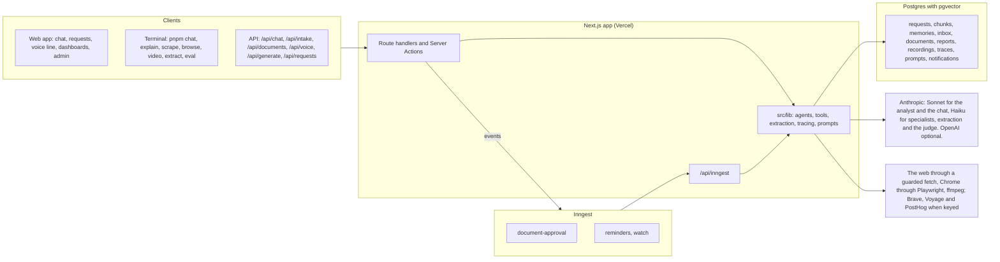

# WorkBot: the architecture as built

WorkBot is the assistant and workflow engine for Fieldstone Supply's operations, finance and support teams, with a public chat for customers. This is the system after Day 19: what runs, where state lives, the models, the design choices and their tradeoffs. Model ids and prices are those configured in `src/lib/providers.ts` on 2026-10-25. Day 40 revisits it.

## The system

The product is one Next.js app; the marketing site in `site/` is a second, static one. Model calls go through one of three paths: the AI SDK for the web routes, the actions, the agents and the workflows (`chatModel`, traced); the provider SDKs directly for the terminal session; and the Claude Agent SDK for the explainer pipeline. Inngest runs the document workflow as checkpointed steps, calling back into the app for each.

## Agents and tools

| Agent                            | Pattern                                           | Model                       | Tools                                                                                                               | Ends when                                 |
| -------------------------------- | ------------------------------------------------- | --------------------------- | ------------------------------------------------------------------------------------------------------------------- | ----------------------------------------- |
| Assistant (web chat, terminal)   | one model, a tool loop up to 8 steps              | large                       | knowledge base (`find`, `ls`, `cat`, `grep`), calculator, `read_url`, notes (employees only), web search when keyed | the model answers in text                 |
| Research analyst (`investigate`) | orchestrator with specialists as tools            | large; specialists on small | `ask_knowledge_base`, `ask_web` (`read_url`, `browse_site`, `web_search`), shared `save_finding`, `write_report`    | `write_report`, or 15 steps, $0.50, 300 s |
| Explainer (`pnpm explain`)       | pipeline on the Claude Agent SDK                  | subagents on small          | researcher with the knowledge base; writer; safety editor with send-back                                            | the editor accepts, at most 2 revisions   |
| Browser agent (`browse`)         | screenshot, one action, repeat                    | small                       | click, type, press, scroll, wait, goto, done, give_up                                                               | done, give_up, or 12 steps                |
| Voice line                       | a state machine in the browser; one call per turn | small                       | intake at the end                                                                                                   | the request is filed                      |
| Document approval                | durable workflow                                  | small                       | classify, extract, a reviewer's event, file, attach, notify                                                         | the reviewer answers, or 3 days           |

The assistant is one agent because its tools are few and its tasks are short. The analyst delegates because the knowledge base and the web need different prompts and limits, and because a specialist on the small model is cheaper than the analyst doing the reading. The explainer is a pipeline because its stages are fixed. Documents are a workflow because a reviewer takes a day, not a request.

## Data

Everything is in one Postgres database, one idempotent schema in `src/lib/schema.ts`. Development and tests run on PGlite with its pgvector build; production needs the `vector` extension installed on its Postgres, which the schema's first statement enables. What is stored where, and why:

- **Requests** are the unit of work: title, body, team, priority, status. Every intake path ends in one: the form, the API, the voice line, a document, the approval workflow.
- **The knowledge base** is 52 Markdown files in `content/knowledge`, indexed into `chunks` by heading, with a full-text vector always and a 1,024-dimension embedding when Voyage is keyed. The files are the source of truth; the index rebuilds from them.
- **Per-person state** is small and erasable: `memories` by visitor cookie, forgotten from `/settings`.
- **Documents and media** keep their derived records, not their bytes, except the inbox, which keeps a document's bytes for the length of its workflow run: `documents` (the extracted record, confidence, the fields to review), `reports` (the analyst's report and findings), `recordings` (frame notes and a timeline).
- **Operations data**: `traces` (every model call: tenant, purpose, prompt version, tokens, cached tokens, dollars, latency, success or the error message; no prompt or reply content), `prompts` (versions and traffic shares), `notifications` (the outbox), `inbox` (the workflow's status per document).

Flows are short. A chat message: cookie to visitor, memories and a compacted history to the prompt, the model with tools, a reply streamed back, memories extracted after the response. A document: bytes to the inbox, an event to Inngest, steps that read the bytes back from the database, a request and a document at the end, a notification in the outbox.

## Technology

| Need                    | Choice                                                                                          | Why this one                                                                                                                                                                                          |
| ----------------------- | ----------------------------------------------------------------------------------------------- | ----------------------------------------------------------------------------------------------------------------------------------------------------------------------------------------------------- |
| App                     | Next.js 16 with Cache Components, React 19                                                      | one codebase for pages, API and actions; static shells with dynamic data behind `io()`; Server Actions for the admin's forms                                                                          |
| UI                      | shadcn/ui on Tailwind 4                                                                         | primitives in the repository, not a dependency to fight; one theme                                                                                                                                    |
| Model calls             | Vercel AI SDK 7; Anthropic and OpenAI SDKs for the terminal                                     | one `generateText`/`streamText` for both providers, structured output and tools included; the raw SDKs where the course taught the wire format                                                        |
| Agents                  | `src/lib/agent.ts`, a 60-line loop; the Claude Agent SDK for the explainer                      | the loop is ours to limit, log and test with a scripted model; the Agent SDK where subagents and hooks save code                                                                                      |
| Structured output       | Zod 4 through `Output.object`                                                                   | one schema is the contract, the validator and the documentation; both providers constrain to it                                                                                                       |
| Database                | Postgres with pgvector; PGlite embedded                                                         | the same SQL in production, development and tests; vectors without a second store                                                                                                                     |
| Workflows and schedules | Inngest                                                                                         | checkpointed steps, a wait for a person that holds no server, cron, retries; a dev server with a dashboard; Vercel integration                                                                        |
| Browser                 | Playwright driving the Chrome installed on the machine (`channel: "chrome"`)                    | nothing to download, but the environment must provide Chrome; the same engine renders test fixtures and takes the course's screenshots                                                                |
| Video                   | ffmpeg on a pipe                                                                                | frames without files on disk; a system binary the environment must provide, which CI installs with apt before the tests                                                                               |
| Tests                   | Vitest, `@inngest/test`, scripted models (`MockLanguageModelV4`), live tests on the small model | unit tests with no network; the real model only where the behaviour is the model's                                                                                                                    |
| Observability           | in-house traces and a dashboard; Langfuse's OpenTelemetry path named                            | no account was available; the records are the same, the seam is one function                                                                                                                          |
| Models                  | Sonnet 5.5 large, Haiku 5.5 small, never Opus by default                                        | the small model reads, extracts, judges and runs specialists at a twentieth of the price per token ($0.10 against $2 per million input, $0.50 against $10 output); the large model decides and writes |

## Tradeoffs

- **Own agent loop over a framework.** The loop is small enough to read and test, and the course needed the mechanics visible. A framework would bring observability and resumability; Inngest supplies the latter where it matters, and the traces the former.
- **One database over several stores.** Vectors, documents' records and operational data all sit in Postgres. Simpler to run and back up; a search-heavy product would move the index to a vector store with its own scaling.
- **The AI SDK's provider adapters over direct SDK calls everywhere.** The adapters cost some control over provider options (caching, effort) in exchange for one call shape, middleware and structured output across providers; each provider constrains output to the schema in its own way, and a schema feature one of them lacks shows up as a retry. The terminal keeps the direct path so the wire format stays in view.
- **Durable workflows for documents, plain requests for chat.** A chat turn is seconds; a document can wait days for a person. The split keeps the fast path simple and gives the slow path checkpoints.
- **In-house tracing over Langfuse.** A table and a page took a day and store no content; Langfuse would add sessions, scores and prompt management with a UI, at the price of an account and content leaving the database. The seam is one function per concern.
- **Browser speech over hosted speech.** No keys, works in Chrome, interruption handled; worse recognition than Deepgram, no audio transcripts for recordings. The interfaces are 2 methods each so the hosted services can take the seats.
- **Small model first.** Haiku reads documents, runs specialists and judges evals; Sonnet writes reports and answers chat. A document costs under a cent in model calls; the risk is quality on hard documents, which the confidence threshold and the reviewer catch.

## Reliability, as built and as missing

Built: step, dollar and time limits on every agent; Inngest's 3 retries per step and a failure handler that marks the document; a retry and a text fallback for the browser; words when embeddings are missing; idempotent filing (the request's creation is its own step); a public-address guard on every fetch; a rate limit on the chat; alerts on error rate and spend; evals with a judge before a prompt takes traffic.

Missing, and in the design brief's plan: a model fallback chain (Sonnet to Haiku, provider to provider) when a call fails; a circuit breaker on a failing provider; a response cache for repeated questions; a shared store for the rate limit across instances; audio transcripts; sign-in, so a tenant is an account rather than a cookie.
