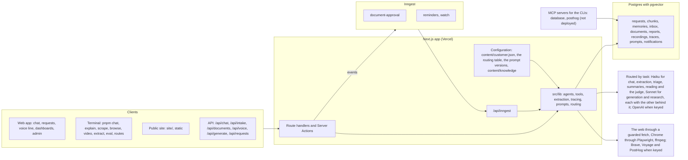

# WorkBot: the architecture as built

WorkBot is the assistant and workflow engine for Fieldstone Supply's operations, finance and support teams, with a public chat for customers. This is the system after Day 26: what runs, where state lives, the models, the design choices and their tradeoffs. Model ids and prices are those configured in `src/lib/providers.ts` on 2026-10-25. Day 40 revisits it.

## The system

The product is one Next.js app; the marketing site in `site/` is a second, static one. Model calls go through one of three paths: the AI SDK for the web routes, the actions, the agents and the workflows (`modelFor(task)`, routed and traced); the provider SDKs directly for the terminal session; and the Claude Agent SDK for the explainer pipeline. Inngest runs the document workflow as checkpointed steps, calling back into the app for each.

## Agents and tools

| Agent                          | Pattern                                           | Model                      | Tools                                                                                                                            | Ends when                                 |
| ------------------------------ | ------------------------------------------------- | -------------------------- | -------------------------------------------------------------------------------------------------------------------------------- | ----------------------------------------- |
| Assistant (web chat, terminal) | one model, a tool loop up to 8 steps              | small (the terminal picks) | knowledge base (`find`, `ls`, `cat`, `grep`), calculator, `read_url`, notes (employees only), web search when keyed              | the model answers in text                 |
| Research agent (`investigate`) | one agent, a tool loop                            | small                      | knowledge base (`find`, `ls`, `cat`, `grep`), `read_url`, `browse_site`, `web_search` when keyed, `save_finding`, `write_report` | `write_report`, or 15 steps, $0.50, 300 s |
| Explainer (`pnpm explain`)     | pipeline on the Claude Agent SDK                  | subagents on small         | researcher with the knowledge base; writer; safety editor with send-back                                                         | the editor accepts, at most 2 revisions   |
| Browser agent (`browse`)       | screenshot, one action, repeat                    | small                      | click, type, press, scroll, wait, goto, done, give_up                                                                            | done, give_up, or 12 steps                |
| Voice line                     | a state machine in the browser; one call per turn | small                      | intake at the end                                                                                                                | the request is filed                      |
| Document approval              | durable workflow                                  | small                      | classify, extract, a reviewer's event, file, attach, notify                                                                      | the reviewer answers, or 3 days           |

The assistant is one agent because its tools are few and its tasks are short. The investigation is one agent too, since Day 26's comparison (the audit below): its specialists cost more and scored no better. The explainer is a pipeline because its stages are fixed. Documents are a workflow because a reviewer takes a day, not a request.

## Data

Everything is in one Postgres database, one idempotent schema in `src/lib/schema.ts`. Development and tests run on PGlite with its pgvector build; production needs the `vector` extension installed on its Postgres, which the schema's first statement enables. What is stored where, and why:

- **Requests** are the unit of work: title, body, team, priority, status. Every intake path ends in one: the form, the API, the voice line, a document, the approval workflow.
- **The knowledge base** is 52 Markdown files in `content/knowledge`, indexed into `chunks` by heading, with a full-text vector always and a 1,024-dimension embedding when Voyage is keyed. The files are the source of truth; the index rebuilds from them.
- **Per-person state** is small and erasable: `memories` by visitor cookie, forgotten from `/settings`.
- **Documents and media** keep their derived records, not their bytes, except the inbox, which keeps a document's bytes for the length of its workflow run: `documents` (the extracted record, confidence, the fields to review), `reports` (the analyst's report and findings), `recordings` (frame notes and a timeline).
- **Operations data**: `traces` (every model call: tenant, purpose, prompt version, tokens, cached tokens, dollars, latency, success or the error message; no prompt or reply content), `prompts` (versions and traffic shares), `notifications` (the outbox), `inbox` (the workflow's status per document).

Flows are short. A chat message: cookie to visitor, memories and a compacted history to the prompt, the model with tools, a reply streamed back, memories extracted after the response. A document: bytes to the inbox, an event to Inngest, steps that read the bytes back from the database, a request and a document at the end, a notification in the outbox.

## Technology

| Need                    | Choice                                                                                                                                                                                                                                   | Why this one                                                                                                                                                                                                                                                                                       |
| ----------------------- | ---------------------------------------------------------------------------------------------------------------------------------------------------------------------------------------------------------------------------------------- | -------------------------------------------------------------------------------------------------------------------------------------------------------------------------------------------------------------------------------------------------------------------------------------------------- |
| App                     | Next.js 16 with Cache Components, React 19                                                                                                                                                                                               | one codebase for pages, API and actions; static shells with dynamic data behind `io()`; Server Actions for the admin's forms                                                                                                                                                                       |
| UI                      | shadcn/ui on Tailwind 4                                                                                                                                                                                                                  | primitives in the repository, not a dependency to fight; one theme                                                                                                                                                                                                                                 |
| Model calls             | Vercel AI SDK 7, behind a routing table per task (`src/lib/routing.ts`); Anthropic and OpenAI SDKs for the terminal                                                                                                                      | one `generateText`/`streamText` for both providers, structured output and tools included; a chain of models per task, so a provider's outage is a slower answer, not an error; the raw SDKs where the course taught the wire format                                                                |
| Agents                  | `src/lib/agent.ts`, a 90-line loop; the Claude Agent SDK for the explainer; the same research agent on LangGraph.js, the Claude Agent SDK and the OpenAI Agents SDK in `src/lib/frameworks/`, for the comparison in `docs/frameworks.md` | the loop is ours to limit, log and test with a scripted model; the Agent SDK where subagents and hooks save code                                                                                                                                                                                   |
| Structured output       | Zod 4 through `Output.object`                                                                                                                                                                                                            | one schema is the contract, the validator and the documentation; both providers constrain to it                                                                                                                                                                                                    |
| Database                | Postgres with pgvector; PGlite embedded                                                                                                                                                                                                  | the same SQL in production, development and tests; vectors without a second store                                                                                                                                                                                                                  |
| Workflows and schedules | Inngest                                                                                                                                                                                                                                  | checkpointed steps, a wait for a person that holds no server, cron, retries; a dev server with a dashboard; Vercel integration                                                                                                                                                                     |
| Browser                 | Playwright driving the Chrome installed on the machine (`channel: "chrome"`)                                                                                                                                                             | nothing to download, but the environment must provide Chrome; the same engine renders test fixtures and takes the course's screenshots                                                                                                                                                             |
| Video                   | ffmpeg on a pipe                                                                                                                                                                                                                         | frames without files on disk; a system binary the environment must provide, which CI installs with apt before the tests                                                                                                                                                                            |
| Tests                   | Vitest, `@inngest/test`, scripted models (`MockLanguageModelV4`), live tests on the small model                                                                                                                                          | unit tests with no network; the real model only where the behaviour is the model's                                                                                                                                                                                                                 |
| Observability           | in-house traces and a dashboard; Langfuse's OpenTelemetry path named                                                                                                                                                                     | no account was available; the records are the same, the seam is one function                                                                                                                                                                                                                       |
| Models                  | Sonnet 5.5 large, Haiku 5.5 small, never Opus by default; the table in `docs/routing.md`                                                                                                                                                 | the small model reads, extracts, triages, judges, runs specialists and answers the chat at a twentieth of the price per token ($0.10 against $2 per million input, $0.50 against $10 output); the large model lays out pages and writes reports; `pnpm routes` measures the rows that have an eval |

## Tradeoffs

- **Own agent loop over a framework.** The loop is small enough to read and test, and the course needed the mechanics visible. A framework would bring observability and resumability; Inngest supplies the latter where it matters, and the traces the former. The same agent built on 3 frameworks (`docs/frameworks.md`) confirmed the loop for the product and chose LangGraph.js for the first agent that must pause for a person and resume (D12).
- **One database over several stores.** Vectors, documents' records and operational data all sit in Postgres. Simpler to run and back up; a search-heavy product would move the index to a vector store with its own scaling.
- **The AI SDK's provider adapters over direct SDK calls everywhere.** The adapters cost some control over provider options (caching, effort) in exchange for one call shape, middleware and structured output across providers; each provider constrains output to the schema in its own way, and a schema feature one of them lacks shows up as a retry. The terminal keeps the direct path so the wire format stays in view.
- **Durable workflows for documents, plain requests for chat.** A chat turn is seconds; a document can wait days for a person. The split keeps the fast path simple and gives the slow path checkpoints.
- **In-house tracing over Langfuse.** A table and a page took a day and store no content; Langfuse would add sessions, scores and prompt management with a UI, at the price of an account and content leaving the database. The seam is one function per concern.
- **Browser speech over hosted speech.** No keys, works in Chrome, interruption handled; worse recognition than Deepgram, no audio transcripts for recordings. The interfaces are 2 methods each so the hosted services can take the seats.
- **Small model first.** Haiku reads documents, judges evals, investigates tickets and, since the table could not separate the 2 on the golden set, answers chat; Sonnet lays out pages. A document costs under a cent in model calls; the risk is quality on hard documents, which the confidence threshold and the reviewer catch.

## Reliability, as built and as missing

Built: a fallback model behind every task (the other size on the same provider), taken when a call fails with a status another model can take, and rehearsed with `OUTAGE`; step, dollar and time limits on every agent; Inngest's 3 retries per step and a failure handler that marks the document; a retry and a text fallback for the browser; words when embeddings are missing; idempotent filing (the request's creation is its own step); a public-address guard on every fetch; a rate limit on the chat; alerts on error rate and spend; the smoke evals as a gate on every pull request that touches a prompt, a tool, a model or an eval, in CI and in the fleet's queue, with the full suite nightly on the scoreboard (`docs/evals.md`).

Missing, and in the design brief's plan: a second provider in the chain, which needs its key and its column in the table; a circuit breaker on a failing provider, so a long outage stops paying for the failed first call; a response cache for repeated questions; a shared store for the rate limit across instances; audio transcripts; sign-in, so a tenant is an account rather than a cookie.

## Audited against the principles (Day 26)

**As it is.** Two deployables: the app (Next.js, on Vercel) and the public site (`site/`, static, 140 lines). One engine, Inngest, for the document workflow and the crons. One database, Postgres with pgvector, 11 tables, JSONB where a record's shape is the model's to decide (documents' records, findings, a recording's scenes). One queue, Inngest's, with an outbox table for notifications. One observability stack, the `traces` table and its page. Two MCP servers for the CLIs, run from the repository, not deployed. Outside: the model providers, Chrome, ffmpeg, and Brave, Voyage and PostHog when keyed. The layers are 3: route handlers and Server Actions, the functions of `src/lib`, and `query` with `$n` parameters in `db.ts`; nothing in between.

| Principle                                       | WorkBot on the morning of Day 26                                                                                                                                                                        | What it costs today                                                                                                                                                                                                                                                              |
| ----------------------------------------------- | ------------------------------------------------------------------------------------------------------------------------------------------------------------------------------------------------------- | -------------------------------------------------------------------------------------------------------------------------------------------------------------------------------------------------------------------------------------------------------------------------------- |
| No microservices                                | one app, and the site as a second deployable                                                                                                                                                            | 12 configuration files for 140 lines of page, a second check in CI, a second deploy; kept, because a public site with no database is a different thing from the app, and folding it in is 2 root layouts and a domain decision                                                   |
| No document databases                           | Postgres only, JSONB for what the model shapes                                                                                                                                                          | nothing                                                                                                                                                                                                                                                                          |
| No RAG by default                               | tools over retrieval since Day 13; embeddings one tool among 4                                                                                                                                          | nothing                                                                                                                                                                                                                                                                          |
| No layered service architecture                 | thin routes, plain functions, typed queries                                                                                                                                                             | nothing; adding a field to a request touches 10 files (the schema, the model, the queries, intake, the API types, the action, the form, the page, the list, a test), which is the price of a typed column and what a per-customer field would avoid with JSONB and configuration |
| No multi-graph agents                           | 3 designs with more than one agent: the analyst with 2 specialists (Day 15), the explainer's 3 subagents (Day 12), the research agent on 3 frameworks (Day 23, a comparison); none validated by an eval | 240 lines and 3 prompts for the analyst; a second runtime for the explainer; on the 17 golden answer cases the analyst's design cost $0.018 and 18 s a question for a score of 0.73                                                                                              |
| Config-first                                    | the routing table (Day 24), the prompt versions (Day 19), the knowledge base as files; the customer in code                                                                                             | a new customer meant edits in 10 source files: the system prompt, intake, the request model, the document filing rules, the voice line, the explainer, the analyst, the frameworks' researcher, the customer sections, the case generator                                        |
| Lightweight app design                          | one database, one queue, one observability stack, one deployable and a static site                                                                                                                      | nothing                                                                                                                                                                                                                                                                          |
| Per-tenant overrides and flags as configuration | `ROUTES` and `OUTAGE` are flags; a tenant is a visitor with no overrides                                                                                                                                | nothing until there is a second tenant                                                                                                                                                                                                                                           |
| Explicit boundaries                             | the browser agent's bounds, `tools.ts`, `db.ts`                                                                                                                                                         | nothing                                                                                                                                                                                                                                                                          |
| Boring technology                               | Postgres, Inngest, Vercel; recordings as bytes in Postgres rather than object storage                                                                                                                   | nothing at this volume                                                                                                                                                                                                                                                           |

**Reading it.** Adding a field: 10 files. A provider down: the chain of Day 24 answers on the next model, and the sentence when none is left. One engineer locally: `pnpm dev` on an embedded Postgres and `pnpm inngest`, nothing else. Regenerated from configuration: the customer, the routes, the prompt versions; not the tools, which are code by choice.

**The 2 migrations.** The customer into configuration: `content/customer.json` names the company, what it is, its teams and what each files, where a document of each kind is filed, and the sections its customers may read; a Zod schema parses it at load and the prompts are functions of it. A new customer is a new file: 10 files touched became 1, 24 mentions of the name in code became 0, and the configured text is unchanged, so the evals did not move. The analyst's specialists into one agent: `pnpm compare:agents`, at the commit before the change (`1d73227`), ran the 17 golden answer cases through the analyst with its 2 specialists, through one agent with the same tools on the large model, and through one agent on the small model, each report scored by the judge with the case's criteria.

| Design                                                     | Score          | A question   | Lines | Prompts |
| ---------------------------------------------------------- | -------------- | ------------ | ----- | ------- |
| The analyst on the large model, 2 specialists on the small | 0.73 (SD 0.20) | $0.018, 18 s | 241   | 3       |
| One agent, the same tools, the large model                 | 0.71 (SD 0.19) | $0.028, 8 s  | 163   | 1       |
| One agent, the same tools, the small model                 | 0.92 (SD 0.16) | $0.0016, 6 s | 163   | 1       |

The delegation added cost and time and no score; the large model's reports scored lower than the small model's under the same judge, which the chat's own eval (0.92 on the small model with the same tools) corroborates. `investigate` is one agent on the research route, which the routing table now sends to the small model first (D13's row superseded): 241 lines became 163, 3 prompts became 1, the log lost its agent column and the cost its breakdown. The comparison, its question settled, went with the commit that ran it.

**Carried into Weeks 7 and 8** (D15 and `brain/architecture/principles.md`): one deployable and the static site; Postgres, JSONB for what the model shapes; tools over retrieval; thin routes and plain functions; one agent unless an eval shows a second helps; the customer, the routes and the prompts as configuration; boring technology; and the 4 questions as the review of any design: how many places a field touches, what happens when a provider is down, whether one engineer runs it locally, what an agent can regenerate from configuration.
