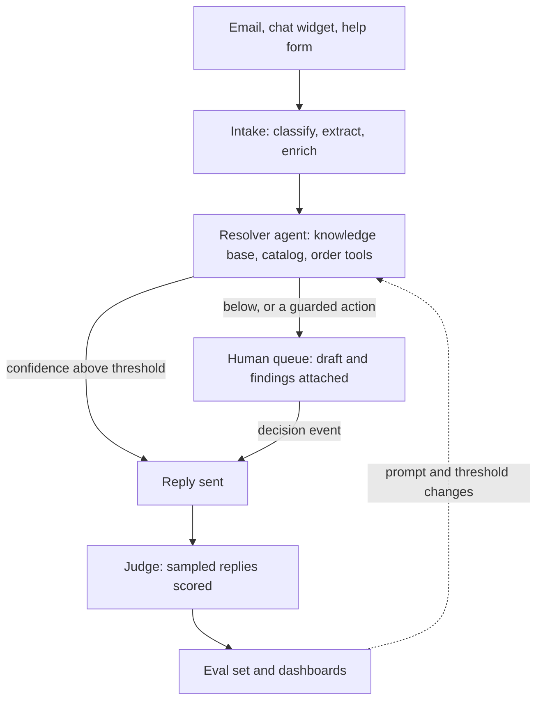

# Design for Brief A: an AI customer support platform

> An e-commerce company with 10,000 daily support tickets wants to automate 80% of responses while maintaining quality. They have a product catalog, an order system and a knowledge base.

This design proposes the architecture, the tradeoffs, the delivery plan and the pitch. Its numbers carry their assumptions; the ones about the company's tickets are hypotheses to confirm in the first week from the triage counts.

## 1. Architecture

### The shape

Three loops, each its own workflow:

1. **Resolve.** A ticket arrives, is classified and enriched with the order and the customer, and a resolver agent answers it from the knowledge base, the catalog and the order system. Above a confidence threshold the answer goes out; below it, a human gets a draft.
2. **Escalate.** Anything the agent must not do alone (a refund over the limit, a complaint, an unknown case) becomes a human task with the agent's draft and findings attached. The human's decision is an event the workflow waits for.
3. **Learn.** Every human edit of a draft, every reopened ticket and every low score from the judge becomes an eval case; the prompts and the thresholds move only when the eval set says so.

### Agents

| Agent    | Job                                                                                                                                                                                                                                               | Model                                                                                                | Tools                                                                                                               | Limits                                                        |
| -------- | ------------------------------------------------------------------------------------------------------------------------------------------------------------------------------------------------------------------------------------------------- | ---------------------------------------------------------------------------------------------------- | ------------------------------------------------------------------------------------------------------------------- | ------------------------------------------------------------- |
| Triage   | kind (order status, return, damage, product question, account, complaint, other), urgency, order id, customer id                                                                                                                                  | small (Haiku 5.5)                                                                                    | none; a structured output, the model filling a schema                                                               | 1 call                                                        |
| Resolver | the answer, with sources, and its own confidence in it                                                                                                                                                                                            | small for order status and policy answers; large (Sonnet 5.5) for complaints and multi-issue tickets | `order_lookup`, `shipment_status`, `catalog_search`, `kb_find`/`kb_cat`, `policy_check`, `draft_reply`              | 6 tool steps, $0.05 a run, 30 s wall clock; 50 runs at a time |
| Actor    | the guarded actions: refund, replacement, address change                                                                                                                                                                                          | large                                                                                                | the same, plus `refund`, `replace`, `update_address`, each behind a policy rule and, over a limit, a human approval | one action per run                                            |
| Judge    | scores a 10% sample of sent replies against criteria per kind: for order status, the right order and the carrier's own status and date; for returns, the policy's window and condition; for complaints, an apology, a next step and no commitment | small                                                                                                | none                                                                                                                | on a schedule                                                 |

The resolver is one agent with tools, as WorkBot's assistant is: tickets are short and the tools are few. There is no orchestrator; the triage call decides the kind and the kind decides the tools and the model. Confidence is the resolver's own score of its answer, as Day 17's extraction scores its fields; it is calibrated per kind on the eval set, where the bar is set at the score above which the judge passes 9 answers in 10, and checked in production by the audit. The actor is separate so that nothing in the resolver's prompt can perform an action: actions are a second run with its own tools, and each tool checks the policy in code (amount, order age, prior refunds) before it acts, with a human approval over the limit.

### Data

| Store                  | What                                                                           | Why there                                                                                                                                                                          |
| ---------------------- | ------------------------------------------------------------------------------ | ---------------------------------------------------------------------------------------------------------------------------------------------------------------------------------- |
| Postgres               | tickets, messages, drafts, decisions, eval cases, traces, prompts              | one store for the product, as WorkBot; the ticket is the unit of work                                                                                                              |
| Postgres with pgvector | the knowledge base and the catalog, split into passages with an embedding each | search by meaning across the 2 corpora inside the same database; rebuilt from the sources                                                                                          |
| The order system       | orders, shipments, customers                                                   | read through its API at the time of the ticket; the agent's `order_lookup` is a thin, logged client, and only the fields it returns for a ticket are kept with that ticket's draft |
| Inngest                | the 3 workflows' state                                                         | a workflow engine: each step's result checkpointed, the wait for a human held without a server, retries, the schedule for the judge, a concurrency limit for the peaks             |
| An object store        | attachments and the photos customers send                                      | bytes do not belong in Postgres beyond a workflow's run; kept for the ticket's retention period, which the help desk sets                                                          |

Flows: a ticket is an event; triage, enrichment and the resolver are steps; the reply is a step keyed by ticket and message id so a retry never sends twice; a reopened ticket re-enters as a new event with its history attached; order data that conflicts with the ticket routes to a human; a human decision is an event the run waits for, up to the SLA; the judge runs on a schedule over a sample.

Retention: tickets and messages stay the company's data in its help desk. The service keeps the drafts, the decisions, the eval cases (with the customer identifiers the help desk already uses, and nothing more), and the traces without content; access is by role, and the eval set is redacted of names and addresses before anyone outside support reads it.

### Technology

Use WorkBot's stack: Next.js for the agent console and the dashboards, the AI SDK with Zod for every model call in the service, Anthropic's models (Haiku for triage, order status and policy answers; Sonnet for complaints and drafts a human will edit, and the fallback for drafting when Haiku's answer fails the bar), Inngest for the workflows, Postgres with pgvector, and, as new work, browser tests of the chat widget on Playwright. Two additions: the company's help desk (Zendesk, Front or Gorgias, through its API and sandbox) stays the channel, so agents keep their tool and the rollout is reversible per kind; and Langfuse (a hosted trace and prompt tool) or WorkBot's own traces for cost per ticket and per kind. Ticket text and the order fields the tools return go to the model provider under its API terms, which exclude training on the data and offer a region; attachments go to the model only for damage claims, where the photo is the evidence. When the help desk's or the shop's API answers 429 or is down, the kind pauses and tickets route to humans; when a model is unavailable, every kind falls to draft-for-human.

### The shape, by the decision framework, and what to build or buy

Task complexity: tickets are short and each kind has a known answer path, so one agent with tools per ticket, and a workflow around it, rather than an orchestrator. Team size: 2 engineers, so few moving parts and a hosted engine rather than an own queue. Scale: 10,000 a day with peaks of 20 to 35 a minute, so events on a queue with a concurrency limit, not request-time work. Latency: a minute for an automatic reply, so the small model first and the large one only where the small one's answer fails the bar.

| Component           | Build or buy                             | Why                                                                                                               |
| ------------------- | ---------------------------------------- | ----------------------------------------------------------------------------------------------------------------- |
| Help desk           | keep theirs                              | the agents' tool and history; a rollout per kind can be paused there                                              |
| Models              | buy, through one API shape               | Anthropic's models through the AI SDK, swappable with the eval set as the test                                    |
| Workflow engine     | buy (Inngest)                            | checkpoints, waits and schedules are its product; an own queue would be weeks of work that earn nothing           |
| Vector search       | own, in Postgres                         | pgvector in the database the service already has; a hosted vector store earns its place past millions of passages |
| Tracing and prompts | buy (Langfuse) or own (WorkBot's tables) | the records are the same; the hosted tool adds a UI and costs an account and data leaving the database            |
| Evals and the judge | own                                      | the eval set is the company's quality bar, built from its agents' edits; nothing to buy for that                  |

### Tradeoffs

- **Confidence threshold over a fixed automation rate.** The brief says 80%; the system says "send when the resolver is sure and the kind allows it". Automation is measured as tickets closed without a human edit within 24 hours, weekly, per kind; a kind goes automatic when 200 eval cases score a mean of 0.9 with no violations, with the judge calibrated against 2 agents' scores on 50 cases first (agreement above 0.8), and a 5% audit of sent replies continues after; a kind whose audit finds more than 1 wrong reply in 100 goes back to drafts. The rate is an outcome, raised kind by kind as the scores earn it, and nothing sends in week 1: the first automatic kind, order status, goes live in week 2 once its cases pass. The 20% that do not auto-send reach a person's queue in the help desk with the draft and the findings, with a first-response target of 1 hour. Promising 80% from day one would mean sending replies the judge would fail.
- **Small model by default.** 10,000 tickets a day is an average of 7 a minute; the busy hours run at 3 to 5 times that, which sets the capacity. Cost: a common ticket is 3 calls on Haiku of about 2,000 input and 300 output tokens, $0.0015 at $0.10 and $0.50 per million; a hard ticket is 4 calls on Sonnet of about 3,000 input and 500 output tokens, $0.05 at $2 and $10 per million. At 10,000 a day with a 20% hard share that is about $115 a day; budget $250 for retries, the judge's 10% sample and cache writes. Model cost is the small part of the whole: the integration work, the hosting (Vercel, Inngest, Postgres: low hundreds a month) and the human review time are the rest, and are not estimated here.
- **The help desk stays.** Building a new inbox would take months and lose the agents' history. Working through its API costs some flexibility in the UI and gains a rollout that can be paused per kind.
- **Actions behind rules, not prompts.** A refund is performed by code that checks the policy (amount, order age, prior refunds) and asks a human above the limit; the model only proposes it. This is slower to build than letting the agent call the order system, and it is what makes an automated refund safe to ship.
- **Evals as the gate.** No prompt or threshold changes without a run of the eval set, built from the humans' own edits. This costs a day of setup and a habit; it is how quality holds while automation grows. The knowledge base and the catalog need a named owner: a source whose answers the judge keeps failing is flagged for that owner, and the set is reviewed monthly.

## 2. Feature proposal

| #   | Feature                                                                                         | Impact                                                                                           | Effort                                                                                                                       | Order        |
| --- | ----------------------------------------------------------------------------------------------- | ------------------------------------------------------------------------------------------------ | ---------------------------------------------------------------------------------------------------------------------------- | ------------ |
| 1   | Triage and routing: every ticket classified, enriched with the order, routed to the right queue | high: every ticket, every agent                                                                  | low: 1 structured call, the help desk's API                                                                                  | week 1       |
| 2   | Order status and delivery replies sent automatically when sure                                  | high: usually the largest kind in e-commerce, to be confirmed from week 1's triage counts        | low: 2 tools, a threshold                                                                                                    | week 2       |
| 3   | Agent assist: a sourced draft on every other ticket, one click to send or edit                  | high: time per ticket should fall, measured against week 1's timings; every edit is an eval case | medium: the resolver with the knowledge base and the catalog                                                                 | week 3       |
| 4   | Policy answers sent automatically: returns windows, shipping, warranties, with the source       | medium: common, and a wrong answer costs trust                                                   | medium: the judge and the eval set first                                                                                     | weeks 4 to 5 |
| 5   | Returns and refunds within policy, with approval over the limit                                 | high: the costliest kind to handle by hand                                                       | high: the actor, the rules, the approval flow in the help desk's ticket view (approve or reject the draft action), the audit | weeks 6 to 8 |

**MVP (weeks 1 to 3):** features 1, 2 and 3, with 2 engineers and API access to the help desk and the shop in week 1. The company sees every ticket triaged, the biggest kind answered automatically, and a draft on the rest. The automation rate at the end of week 3 equals the share of order-status tickets that pass the bar, a figure week 1's triage counts give; the eval set has a few hundred cases from the agents' edits; the dashboards show cost per ticket and the judge's scores per kind. First-response targets: 1 minute for an automatic reply, 1 hour for a human one. For the return on it, an illustration with its assumptions: an agent who handles 60 tickets a day at $25 an hour costs about $3.30 a ticket, so each 10% of automation at 10,000 tickets a day is about $3,300 a day of agent time back, against cents of model cost; the real figure needs their agent cost and ticket times from week 1.

**What to promise:** triage on every ticket from week 1, with its accuracy measured against the agents' corrections; automatic replies only for kinds that pass the eval set, starting with order status; a draft on every ticket; every automatic reply sampled by the judge, and a human path on every ticket; cost per ticket in cents, visible per kind.

**What to caveat:** 80% is a destination reached kind by kind, not a switch; the first month's number will be lower and known; the model will be wrong sometimes, which is why replies carry sources and the judge samples them; refunds and replacements need the rules and the approval flow before they are automated, which is weeks 5 to 8; the knowledge base's gaps become the agent's gaps, and someone has to own the knowledge base; the timeline assumes the help desk's and the shop's APIs exist, are documented and have a sandbox.

## 3. The pitch, in 5 minutes

1. **The problem in their numbers (30 s).** 10,000 tickets a day. In e-commerce most are a few kinds of question, and the answer is usually in a system they already have: the order, the policy, the catalog; week 1's triage counts will say how many here. The cost is the agents' time and the customer's wait.
2. **What we build (60 s).** Three loops: resolve, escalate, learn. One picture. The agent answers from their own systems with the source shown; what it must not do alone goes to a person with the draft attached; every edit teaches the next version.
3. **Why it holds quality (60 s).** Nothing is sent below a confidence bar; the bar is per kind and earned on an eval set built from their own agents' edits; a judge samples what is sent; a human path exists on every ticket; actions are code with rules, not a prompt.
4. **The plan and the numbers (60 s).** Weeks 1 to 3: triage, order status, drafts; the automation rate by week 3 is the order-status share that passes the bar, measured. Weeks 4 to 5: policy answers; weeks 6 to 8: returns and refunds. Model cost about $115 a day at full volume, budgeted at $250; hosting in the low hundreds a month; the integration work is the real cost. Keep the existing help desk as the ticketing interface.
5. **What I need from you (30 s).** API access to the help desk and the order system; the knowledge base with an owner; 2 agents for a week to label the first eval set; a decision on the refund limit a machine may approve.
6. **Questions (60 s).** Feasibility: WorkBot does each piece today, on the same stack. Timeline: 3 weeks to the MVP, 8 to refunds, with 2 engineers and the APIs available. Cost: model cost in cents a ticket, hosting in the low hundreds a month, the integration work estimated once the APIs are seen. Privacy: the agent reads the order system at the time of the ticket, keeps only the fields it used, and the traces hold no content. Lock-in: one schema serves Anthropic and OpenAI through the AI SDK; the models are swappable, with the eval set as the test of a swap. Languages: the models handle the common ones, and the eval set must hold cases in each the company serves. Brand voice: the prompt's style section, with the judge's criteria checking it.

## Terms

Structured output: the model fills a schema instead of writing free text. Confidence: the model's own score of its answer, calibrated against a judge. Idempotency key: a value a retried step carries so the same reply is never sent twice. Checkpoint: a step's recorded result, which a resumed run reads instead of running the step again. pgvector: vector search inside Postgres. Inngest: the workflow engine behind the steps, waits and schedules. Zod: schema validation in TypeScript. Playwright: browser automation, used for tests.
