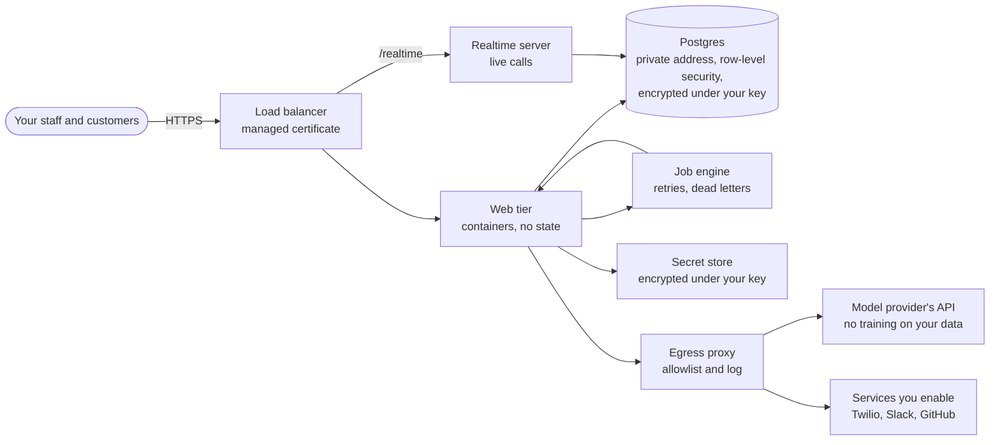

# WorkBot for your security review

One page for a customer's reviewers: what WorkBot is made of, where your data goes, and where each claim can be checked. The full answers are in [security.md](security.md), [isolation.md](isolation.md) and the [questionnaire](questionnaire.md).

**Where your data goes.** Into Postgres in the region you choose, under row-level security by customer, encrypted with a KMS key of your environment's own; into the model provider's API for each question, with only what the asking user's role may read; and nowhere else, since every outbound call passes an allowlist. A customer that requires it gets its own project, database and key.

**Who can read it.** Your users by role, enforced below the AI on every page, action and tool; the services' own account, which may read their secrets and nothing else; and named operators through your cloud's IAM, with every read of a secret logged.

**When the AI is tricked.** It cannot do more than the user it acts for: tools are checked against the user's role outside the model, writes need a key and allow a dry run, and 20 injection attempts run as an evaluation on every change.

**How long it is kept, and how it ends.** Conversations 90 days and documents' contents 30 days by default, each configurable, enforced nightly. A customer's rows can be deleted on request; a customer's own stack ends with its key.

**What is not covered by this page.** Agreements: a HIPAA business associate agreement is between you and each vendor that touches patient data, including the cloud and the model provider ([hosting.md](hosting.md)), and this page is not one.
